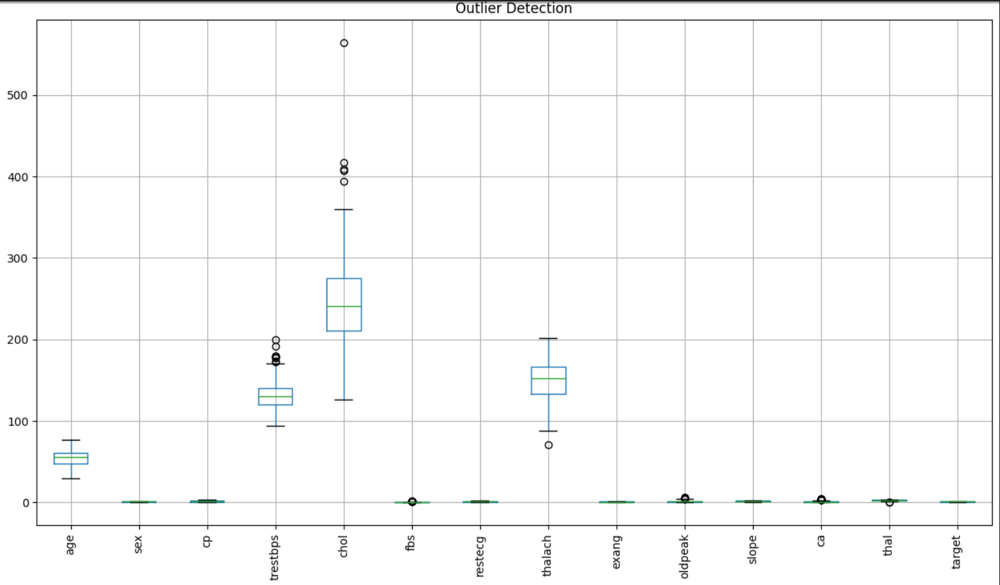
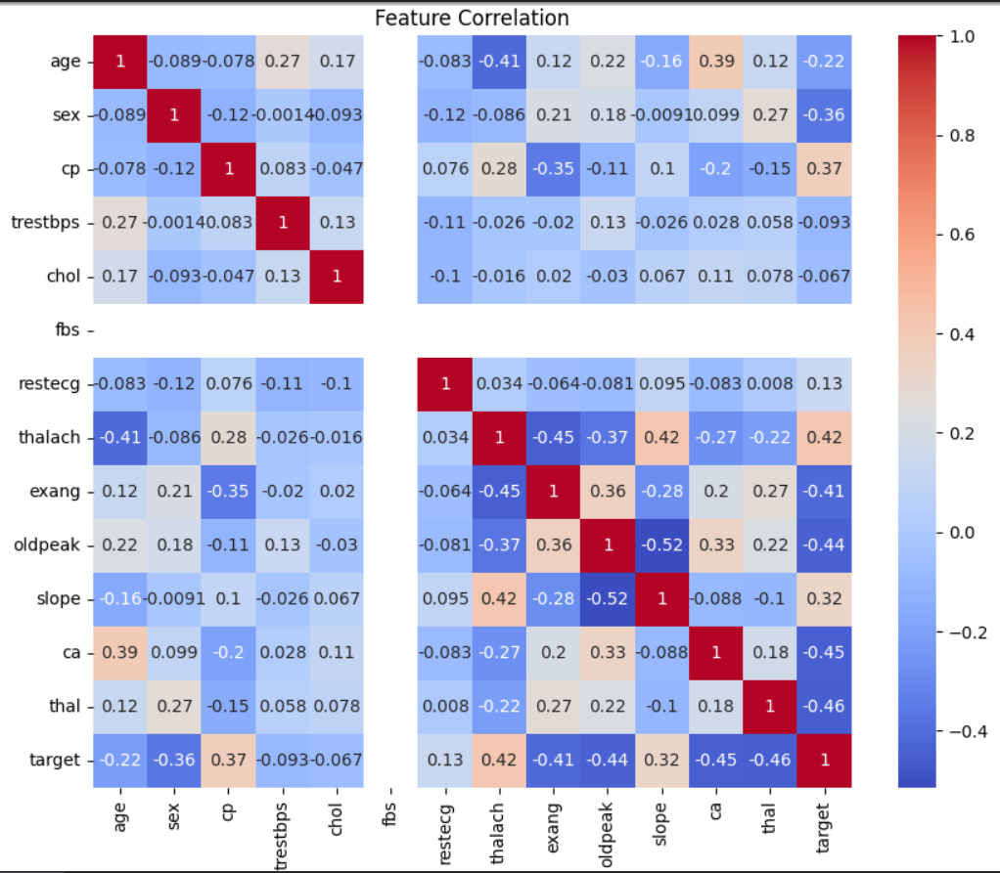
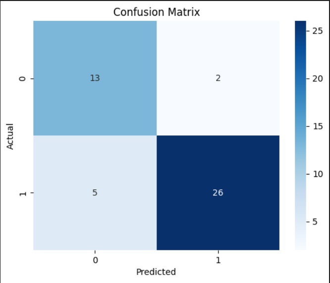
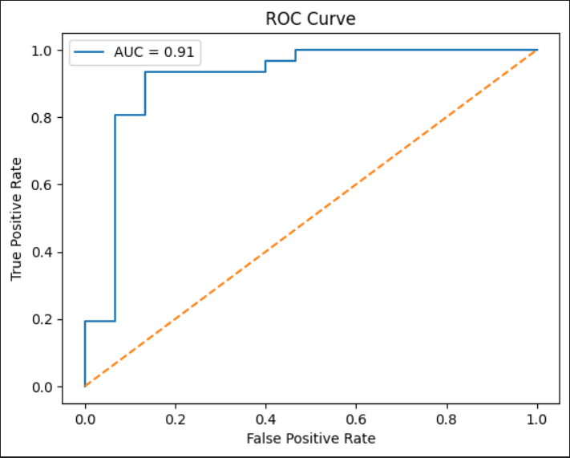

# 🫀 Heart Disease Prediction System


---

## 📌 Problem Statement

Heart disease is one of the leading causes of death worldwide. Early detection and risk assessment are critical in preventing fatal outcomes. This project builds a **Machine Learning web application** using **Logistic Regression** that predicts the risk of heart disease based on a patient's medical attributes such as age, cholesterol levels, chest pain type, and heart rate. The model is deployed as an interactive **Streamlit web app** with light/dark theme support.

---

## 📂 Dataset

- **Source:** UCI Heart Disease Dataset (cleaned version)
- **File:** `HeartClean_Dataset.csv`
- **Rows:** 302 patients
- **Columns:** 14 features
- **Target:** `1` = Heart Disease Present (164 patients), `0` = No Heart Disease (138 patients)
- **No missing values** in the dataset

| Feature | Description |
|---|---|
| `age` | Age of the patient |
| `sex` | Sex (1 = Male, 0 = Female) |
| `cp` | Chest pain type (0–3) |
| `trestbps` | Resting blood pressure (mmHg) |
| `chol` | Serum cholesterol (mg/dl) |
| `fbs` | Fasting blood sugar > 120 mg/dl (1 = Yes) |
| `restecg` | Resting ECG results (0–2) |
| `thalach` | Maximum heart rate achieved |
| `exang` | Exercise induced angina (1 = Yes) |
| `oldpeak` | ST depression induced by exercise |
| `slope` | Slope of peak exercise ST segment |
| `ca` | Number of major vessels (0–3) |
| `thal` | Thalassemia type (0–3) |
| `target` | Heart disease present (1 = Yes, 0 = No) |

---

## 🛠 Tech Stack

- Python
- Pandas & NumPy
- Matplotlib & Seaborn
- Scikit-learn (Logistic Regression, StandardScaler)
- Streamlit (Web App Deployment)
- Pickle (Model Serialization)
- Google Colab

---

## 📁 Folder Structure

```
Heart_Disease_Prediction-main/
│
├── Heart_MLModel.ipynb
├── HeartClean_Dataset (1).csv
├── app.py
├── heart_model.pkl
├── scaler.pkl
├── requirements.txt
└── README.md
```

---

## 💡 Key Insights

- ❤️ **54.3% of patients** in the dataset have heart disease, making it a near-balanced classification problem
- 👨 **68.2% of patients are male**, and male patients show a higher risk of heart disease in this dataset
- 📊 **Logistic Regression achieved 84.78% accuracy** on the test set after outlier removal and feature scaling
- 🔁 **Outlier removal** reduced the dataset from 302 → 228 records using IQR method for cleaner training
- 🩺 **Asymptomatic chest pain (cp=3)** is the strongest predictor of heart disease presence
- 💓 **Higher maximum heart rate (thalach)** is associated with lower risk — patients without disease had significantly higher heart rates
- 📉 **Oldpeak (ST depression)** shows a strong positive correlation with heart disease risk
- 🧪 **Thalassemia type** is among the top features correlated with the target variable

---

## 📊 Visualizations

### Plot 1 — Outlier Detection (Boxplot)


### Plot 2 — Correlation Heatmap of Features


### Plot 3 — Confusion Matrix


### Plot 4 — ROC Curve


---

## 📋 Model Performance Scorecard

| Metric | Value |
|---|---|
| Dataset Size | 302 patients |
| After Outlier Removal | 228 patients |
| Train/Test Split | 80% / 20% |
| Algorithm | Logistic Regression |
| Accuracy | **84.78%** |
| Precision (Heart Disease) | 93% |
| Recall (Heart Disease) | 84% |
| F1-Score (Heart Disease) | 88% |
| Linear Regression R² Score | 0.50 (baseline comparison) |
| Model Saved As | `heart_model.pkl` |
| Scaler Saved As | `scaler.pkl` |

---

## 🌐 Streamlit Web App Features

- 🔢 Input fields for all 13 medical attributes (age, sex, chest pain, cholesterol, etc.)
- 🎨 **Light / Dark theme toggle** via sidebar
- ⚡ Instant prediction on button click — **High Risk** or **Low Risk**
- ⚠️ Medical advisory message shown for high-risk patients
- 📦 Pre-loaded `heart_model.pkl` and `scaler.pkl` for real-time inference

---

## ▶️ How to Run

1. Clone the repo
```bash
git clone https://github.com/nishhh2004/Heart_Disease_Prediction.git
cd Heart_Disease_Prediction
```

2. Install dependencies
```bash
pip install -r requirements.txt
```

3. Run the Streamlit app
```bash
streamlit run app.py
```

4. To retrain the model, open `Heart_MLModel.ipynb` in Jupyter or Google Colab and run all cells

---

## ✅ Medical Recommendations from Data

- **Focus on high-risk groups** — males aged 50–65 with asymptomatic chest pain are the highest risk segment
- **Monitor thalassemia patients** — reversible defect type shows the strongest correlation with heart disease
- **Track ST depression (Oldpeak)** — values above 2.0 significantly increase risk
- **Prioritize patients with exercise-induced angina** — this feature strongly predicts positive cases
- **Regular ECG screening** — ST-T wave abnormalities in resting ECG indicate elevated risk
